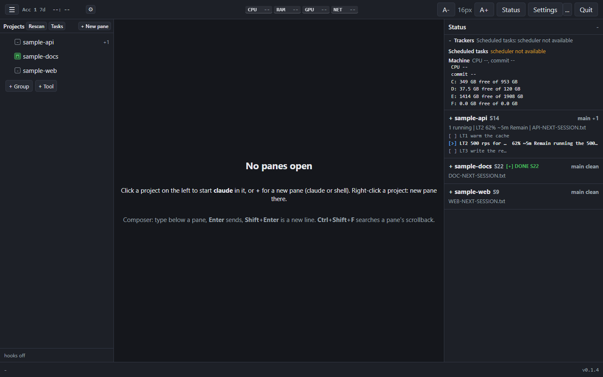
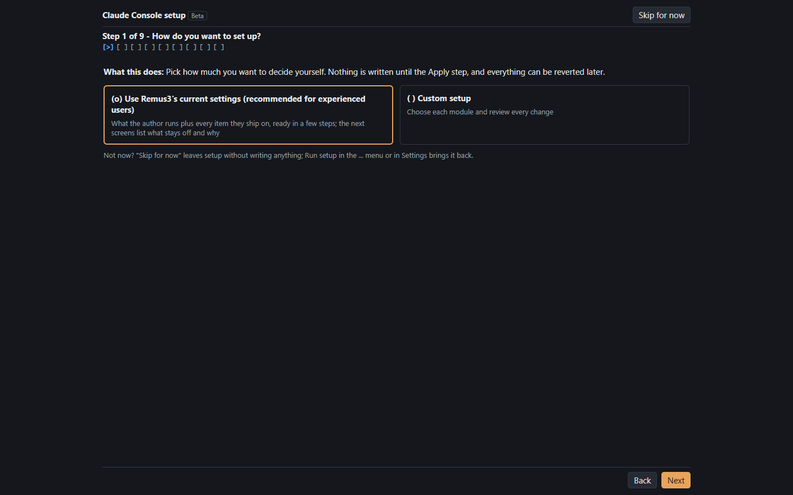
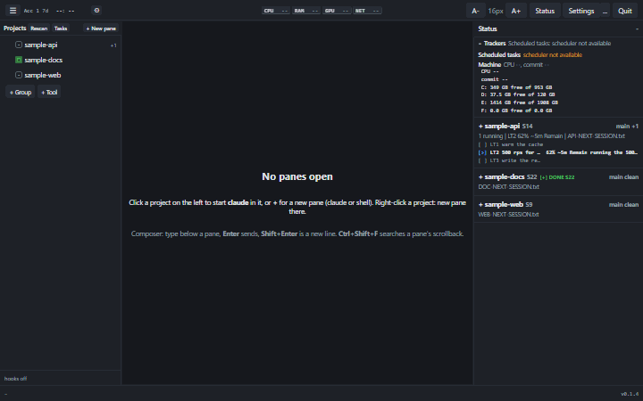
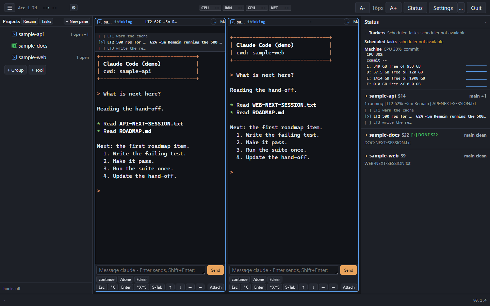
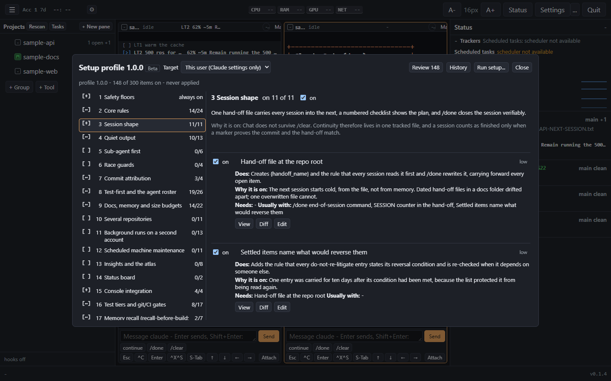
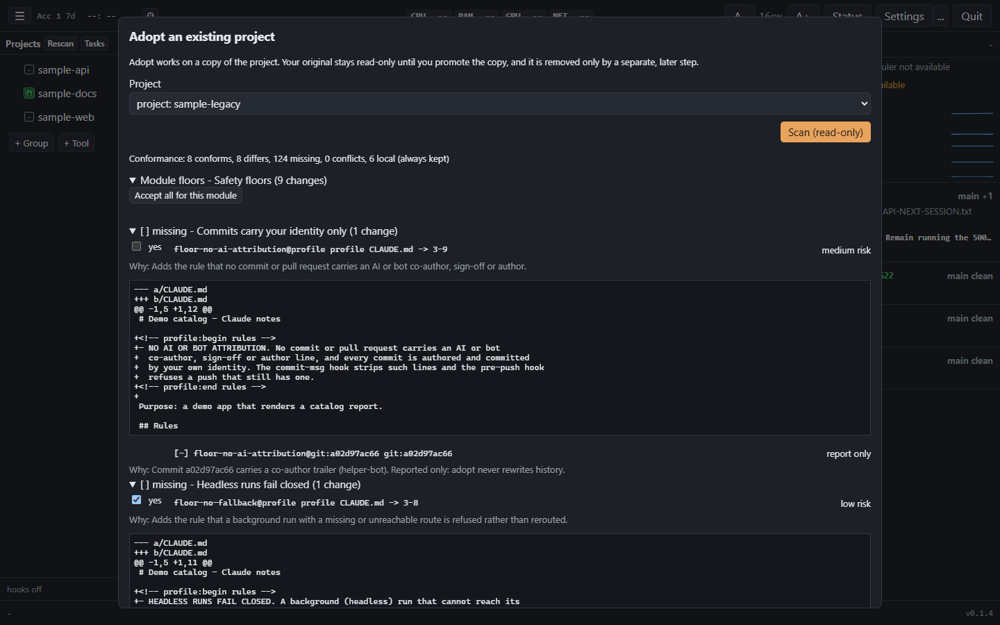
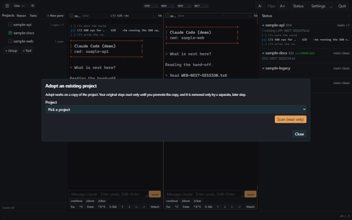
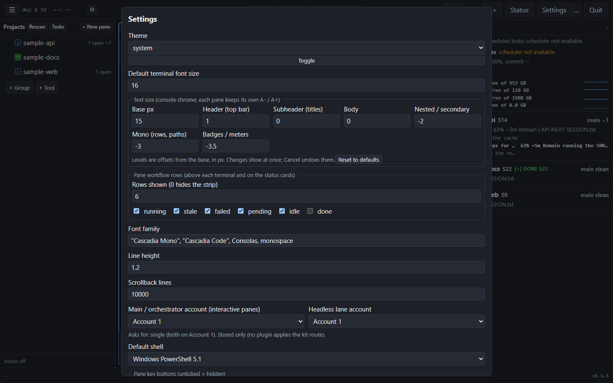

# Claude Console

[](https://github.com/Remus3/Claude-Console/releases/latest)
[](https://github.com/Remus3/Claude-Console/actions/workflows/ci.yml)
[](LICENSE)
[](https://github.com/Remus3/Claude-Console/releases)
[](#requirements)

Claude Console is a desktop window for [Claude Code](https://claude.com/claude-code) on
Windows. It runs your Claude Code sessions and shells side by side in tiled terminal
panes, lists the git projects on your drive with their branch and changes, and shows
each project's hand-off and progress files at a glance. Everything runs on your own
computer: the server listens on 127.0.0.1 only and every request needs a token made at
start.



## Requirements

- Windows 10 or 11.
- The Claude Code CLI, for Claude panes. Not installed yet? In PowerShell:
  `irm https://claude.ai/install.ps1 | iex`. Shell panes work without it.
- Node.js 24 or newer and Git: the installer installs both for you when they are
  missing (winget, or the official installers as a fallback).
- Microsoft Edge (part of Windows) for the app window; without it the console opens
  in a normal browser tab.
- Python 3, only if you turn on setup-profile modules whose hooks are Python scripts.
  The setup names them before it writes anything.

## Install

Open **Windows PowerShell** and run:

```powershell
irm https://github.com/Remus3/Claude-Console/releases/latest/download/install.ps1 | iex
```

That one command installs Node.js and Git when needed, downloads the latest release,
checks it against the release's `SHA256SUMS.txt`, installs it to
`%LOCALAPPDATA%\Programs\claude-console`, adds **Claude Console** to the Start menu,
the Desktop and Apps & features, puts the `claude-console` command on your user PATH,
and starts the console. It takes about a minute plus the Node.js / Git downloads.
Running it again upgrades or repairs the install. If Node.js or Git is missing and
winget is unavailable, Windows will ask for permission once to install it.

### Install without running a remote script

1. From the [latest release](https://github.com/Remus3/Claude-Console/releases/latest)
   download `install.ps1`, `claude-console-<version>.zip` and `SHA256SUMS.txt` into one
   folder.
2. Read `install.ps1`. Then, in that folder:

   ```powershell
   powershell -ExecutionPolicy Bypass -File .\install.ps1 -Zip .\claude-console-<version>.zip
   ```

   It verifies the zip and installs exactly as above.

Fully by hand (Node.js 24+ already installed): compare
`Get-FileHash .\claude-console-<version>.zip -Algorithm SHA256` with `SHA256SUMS.txt`,
extract the zip, and run in the extracted `claude-console-<version>` folder:

```powershell
node bin\claude-console.js install --repo Remus3/Claude-Console
```

## First run

The console opens in its own window. Later, start it from the Start menu or Desktop
(**Claude Console**), or with `claude-console start --open` in a new terminal.

The left side lists the git projects it finds directly under `C:\`. Click a project to
open a Claude pane there; right-click for a shell pane. To show projects that live
elsewhere, add their parent folders as `scanRoots`, or single folders as
`extraProjects`, in `%LOCALAPPDATA%\Programs\claude-console\data\console.local.json`
(same shape as `config/console.json`; your edits there survive every update). If
Claude Code sits in an unusual place, set `"claudePath"` to the full path of
`claude.exe` in that file. Every feature is described in
[docs/capabilities.md](docs/capabilities.md).

On the first start a thin strip at the top offers the optional setup profile. It is
never a pop-up, and you can dismiss it for good. Open it later from the `...` menu,
**Setup profile**, or Settings > Setup profile > **Run setup**. The setup starts with
one question, and you can switch between the two answers on any screen:

- **Use Remus3's current settings** is the quick path for experienced users: what the
  author runs, plus every item the author ships on by default. It shows the author's
  modules at a glance, with the items the preset leaves off and why, asks only for the
  inputs that cannot be guessed (environment variables, keys, a second account, your
  git identity), asks one yes or no for all scheduled tasks, and previews the result.
  Skip any input and the modules that need it stay off, marked `off - needs <input>`.
  The review step records your choices in the console data folder, so a setup you leave
  before Apply still shows what you picked. Settings that live in your Claude account
  folder are applied to every configured account that has its own folder; an account
  without one (or sharing a folder or name with another) is flagged in the account step
  and in Settings.
- **Custom setup** lets you choose each module and each item and review every change.
  If you started on the quick path, your custom choices begin from the author's
  settings.

Each screen says `Step x of y`, has a Back button and explains what it does. Nothing
is written until the last step, **Apply and verify**.



## Daily use



- Each pane is a real terminal. Type in the box under a pane: **Enter** sends,
  **Shift+Enter** starts a new line, and the buttons send `continue`, `/done`, `/clear`
  and the keys Claude Code uses.
- Above a pane, the project's progress files show as rows (`[>]` running, `[ ]` to do)
  with percent and time left; the same rows sit on the project's card in the Status
  panel on the right.
- A project whose last session ended with a verified `/done` shows a green `DONE`
  mark on its card until new work starts.



## Setup profile (optional, beta)

The setup profile can set Claude Code up the way this console's author works. It is a
set of modules: a hand-off file per project and a `/done` ritual, quiet output,
test-first agents, commit identity hooks, size budgets for Claude's instruction files,
and more. Each module is a group of items, and each item says what it does, why the
author turns it on, which items it needs and which it usually goes with.

You decide what is on. Turn a module on or off as a whole, or turn single items on
and off inside it; dependencies are always shown and never switched silently. The
safety floors are the one module that is always on, because they keep the rest
reversible. Before you enable a module, read its description and the `.md` files it
adds to your project, so you know which rules Claude will follow. The full list, with
the reason each module exists and when you might turn it on later, is in
[docs/profile.md](docs/profile.md).

The same choices work from a terminal:

```powershell
claude-console profile list                      # every module and item, on or off
claude-console profile view session              # what one module or item does and why
claude-console profile enable ci-gates           # change your selection only
claude-console profile apply --target repo:C:\code\my-app             # dry run: every change
claude-console profile apply --target repo:C:\code\my-app --apply --yes
claude-console profile revert --last --apply --yes   # undo the last apply, byte for byte
```

`apply` without `--apply --yes` is always a dry run. A real apply backs up everything it
touches first, reads every write back, and rolls the whole change back if one write
fails. The setup profile never commits, never pushes and never starts a background
Claude run on its own; after an apply it prints a suggested commit message for you.



## As-is, and the safeguards

The console and its setup profile are provided as-is under the Apache-2.0 licence, and
the author is not liable for what they do on your machine. That is why the setup is
built so you can look before anything changes and undo what you did:

- `[+]` Dry run: every change is shown before it is written.
- `[+]` Copy first: adopting a project works on a copy, never on the original.
- `[+]` Your choice: every module and every change has its own yes or no.
- `[+]` Backups: each apply keeps what it replaces, and revert restores it.
- `[+]` Recycle Bin: files the profile created are recycled when removed.
- `[+]` No telemetry: see Privacy below.
- `[+]` Stop everything: one switch halts what the console and the profile started.

## Adopting an existing project

You can bring a project you already have in line with the profile without risking it.
The console never changes the original while it works:

1. **Copy.** It makes a full copy of the project (a branch of its own when the git
   tree is clean) and shows the size first, so you can leave out folders such as
   `node_modules`.
2. **Report.** It scans the copy and lists, per rule, every file and line it would
   change, with the diff, the reason and a warning where a change might break
   something (for example a data file that must keep Windows line endings).
3. **Yes or no.** You accept or refuse each module and each change.
4. **Function check.** It applies your choices to the copy, then runs your project's
   own tests, build and start command on both the original and the copy and compares
   them. If the copy does worse, it names the change that caused it and offers to undo
   just that change. You confirm that the copy works by typing `works`.
5. **Promote.** Only then can the copy become your project, by a git merge or by
   swapping the folders. The old folder is kept aside.
6. **Remove the original, later.** A separate step, offered at the earliest a day
   after promoting, sends the kept original to the Recycle Bin or a zip archive.

Start it from the `...` menu, **Adopt a project...**, or with
`claude-console profile adopt <project-folder> --report`. The details are in
[docs/adopt.md](docs/adopt.md).





## Privacy

Nothing you do in the console is sent to its author or to anyone else: not your files,
prompts, settings, secrets or usage. There is no telemetry and no crash upload. The
console makes exactly two kinds of network call. One is the update check and download
from this repo's GitHub releases. The other is an action you start yourself, such as an
install step or opening an issue page or claude.ai in your browser. The server, the
panes and an optional background-run proxy talk over 127.0.0.1 only, and tests in this
repo fail the build if any other network call appears. The full statement, with every
allowed host, is in [docs/privacy.md](docs/privacy.md).

## Update

The console checks this repo's releases once a day (one anonymous request; turn it off
with `"updates": {"check": false}` in `console.local.json`). When a new version is out,
an **Update available** badge appears in the top bar; click it, or open Settings >
Updates & repair. Your settings, layouts and local file changes are kept: a file you
changed is merged with the new version, and a clash is kept aside for you to review.
From a terminal: `claude-console update --yes`. Automatic updates inside a night window
can be turned on in Settings > Updates & repair.

When the author's settings change in a new version, users of the quick path see
**Update to Remus3's latest settings** with the list of changes; users of a custom
setup get the changes merged into their own choices, with any clash listed for them to
decide. Nothing is applied without the usual preview.



## If something breaks

- **Stop everything** (the `...` menu, or `claude-console stop-all`) ends the
  processes the console started (its panes and background runs, by recorded process
  id only), pauses the scheduled tasks the setup profile added and turns the profile's
  hooks off. `claude-console resume` turns them back on. It never touches anything the
  console did not start.
- **The console itself will not start**: run the standalone recovery script. It needs
  no Node.js, no server and no network, and `-WhatIf` only shows what it would do:

  ```powershell
  $r = Get-ChildItem "$env:LOCALAPPDATA\Programs\claude-console\app\*\release\recover.ps1" | Select-Object -Last 1
  powershell -ExecutionPolicy Bypass -File $r.FullName -WhatIf -Stop -DisableHooks -PauseTasks
  ```

  `-Stop`, `-DisableHooks` and `-PauseTasks` do it, `-Resume` undoes it,
  `-Revert last` restores the files of the last profile change, and `-Prompt` writes a
  scrubbed help text for claude.ai. `recover.ps1` is also attached to every release.
- **Even the script cannot run**: [docs/recovery.md](docs/recovery.md) walks through
  the same steps by hand.

## Getting help

Settings > **Report a problem** (also on any failed setup check), or
`claude-console crash-report`, builds a short report: versions, the failing step and
the console's own recent log lines. Names, paths, tokens and anything that looks like
a secret are scrubbed, and pane output, prompts and your files are never included. You
see the exact text first, then pick one of three ways:

- **Open a GitHub issue** on this repo, pre-filled with the report.
- **Ask my Claude to fix it**: a new Claude pane gets the report and is told to find
  the cause and change nothing until you agree.
- **Save to file**, to attach or read later.

If Claude itself is broken, the `...` menu's **Get help in the browser** (or
`claude-console recover-prompt`) copies a self-contained recovery text, with the exact
undo steps, to the clipboard and opens claude.ai so you can paste it into a new chat.

## Uninstall

Changes the setup profile made to your projects and Claude settings are separate from
the program. Remove them first if you want them gone:
`claude-console profile uninstall --all` shows what it would remove, and adding
`--apply --yes` removes it (files you edited since are kept and flagged).

Then remove the console: Apps & features > **Claude Console** > Uninstall, or in a
terminal:

```powershell
claude-console uninstall
```

This removes the shortcuts, the Apps & features entry, the PATH entry and the program
files. Your settings and layouts in `%LOCALAPPDATA%\Programs\claude-console\data` stay;
`claude-console uninstall --purge` moves them to the Recycle Bin too. Node.js, Git and
Claude Code stay installed.

## Troubleshooting

| What you see | What to do |
|---|---|
| `Claude Code CLI not found` | Install it: `irm https://claude.ai/install.ps1 \| iex`, then open a new pane. Installed elsewhere: set `"claudePath"` in `console.local.json` to the full path of `claude.exe`. |
| `Git not found` during install | The console still works; projects show without git status. Install Git (`winget install Git.Git`) and run the install command again. |
| The install stopped with a self-test failure | The output names the failing test and the error, plus the path of the full test log and the report under `%LOCALAPPDATA%\Programs\claude-console\reports`. Run the install command again after fixing the cause. |
| `claude-console` is not recognized | Open a new terminal (PATH changes reach new windows only), or use the full path `%LOCALAPPDATA%\Programs\claude-console\claude-console.cmd`. |
| The window does not open | `claude-console status` says whether the server runs; `claude-console stop`, then `claude-console start --open`. |
| `stop failed: the console server (pid N) is still running` or `uninstall incomplete: ...` | A program still holds the console open. `claude-console stop --force` ends the server; then run the uninstall again. The line names what is left. |
| Port 7800 is taken | Set `"port"` in `console.local.json` to a free port. |
| A setup check failed after Apply | The whole change was rolled back; the failed row names the item and the reason. Fix it or turn that item off, then apply again. |
| `off - needs <input>` in the setup | You skipped an input that module needs. Go Back to the inputs step, or leave the module off. |
| Claude behaves oddly after a profile change | `claude-console profile revert --last --apply --yes` undoes the last apply; `claude-console profile status` shows what is applied. |
| Something else is broken | `claude-console reinstall` shows a read-only report and the exact command for a repair or a fresh reinstall; your data is kept. |

## Build from source

```powershell
git clone https://github.com/Remus3/Claude-Console
cd Claude-Console
npm ci
npm test
launch.cmd
```

`launch.cmd` runs the server in the foreground; `launch.vbs` starts it hidden. Both
find Node.js on PATH, else in its standard install folder. `claude-console release
--out DIR` builds the release assets (zip, `install.ps1`, `SHA256SUMS.txt`, notes).

## License

Apache License 2.0, see [LICENSE](LICENSE) and [NOTICE](NOTICE). Claude Console is an
independent project and is not made by or affiliated with Anthropic. Claude and
Claude Code are trademarks of Anthropic.
