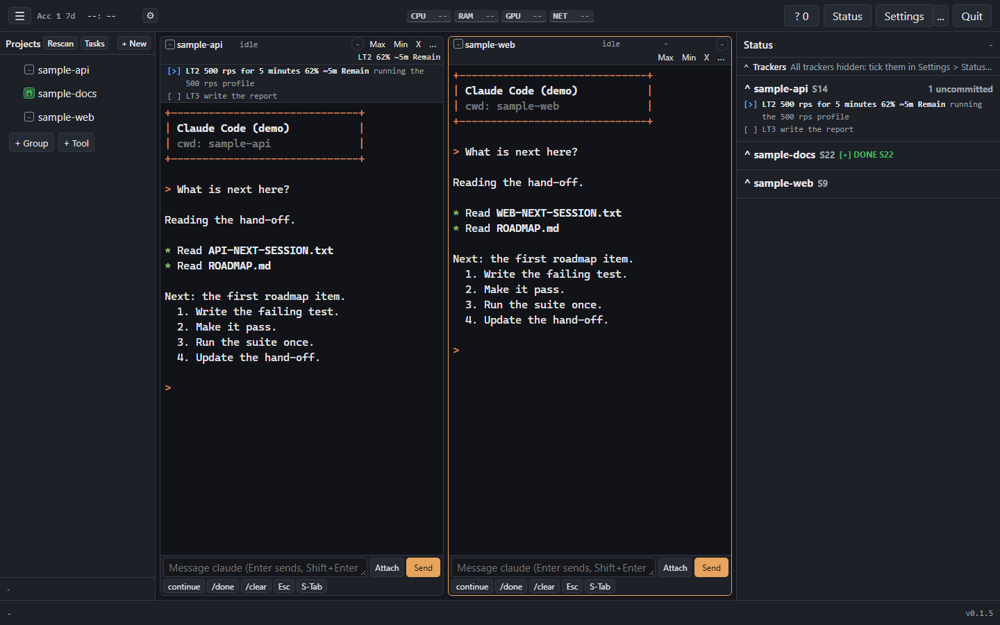
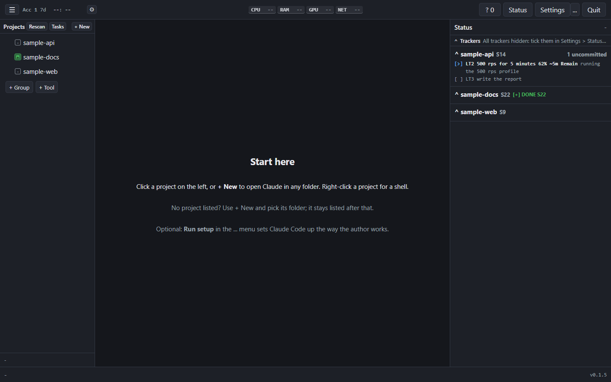
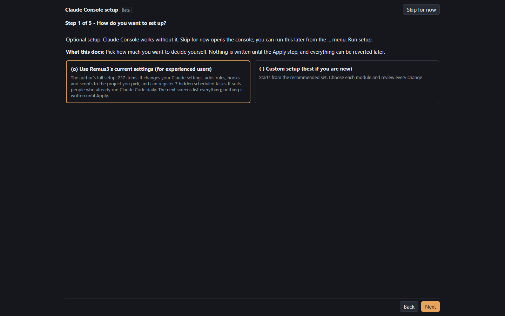
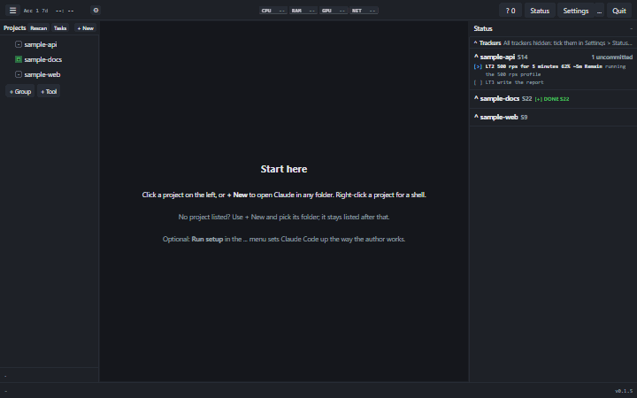
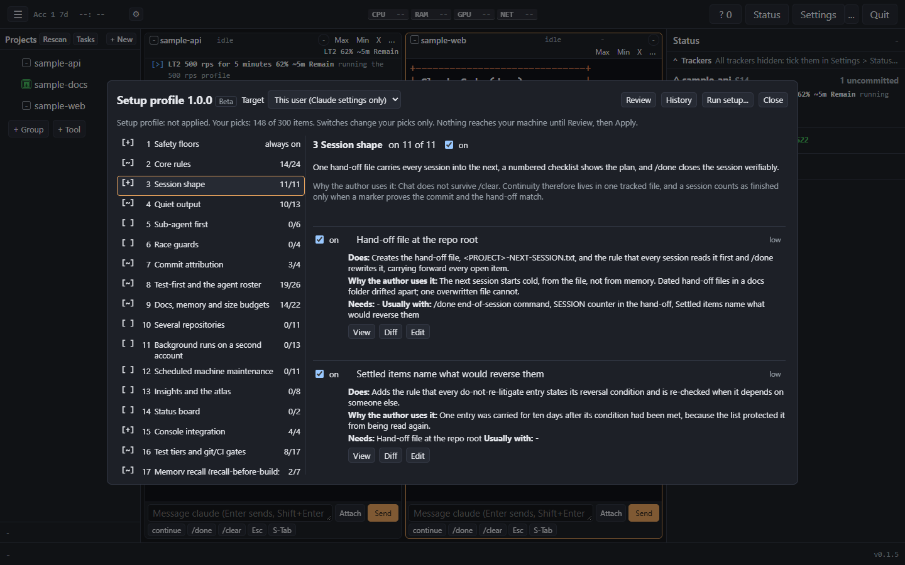
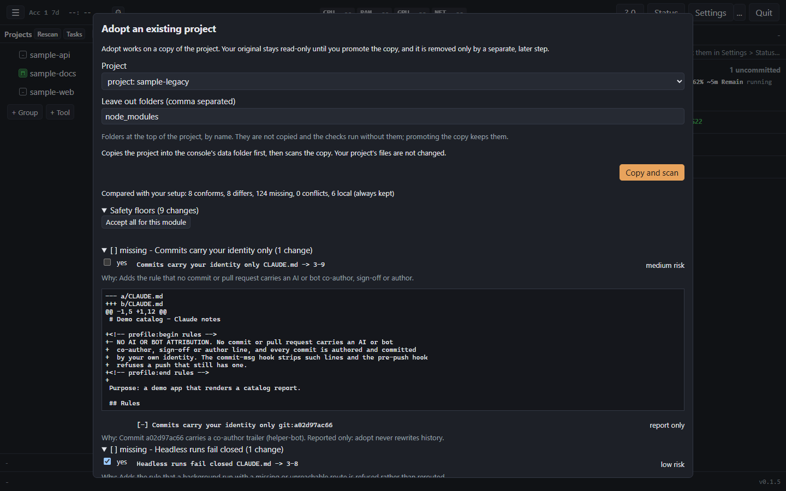
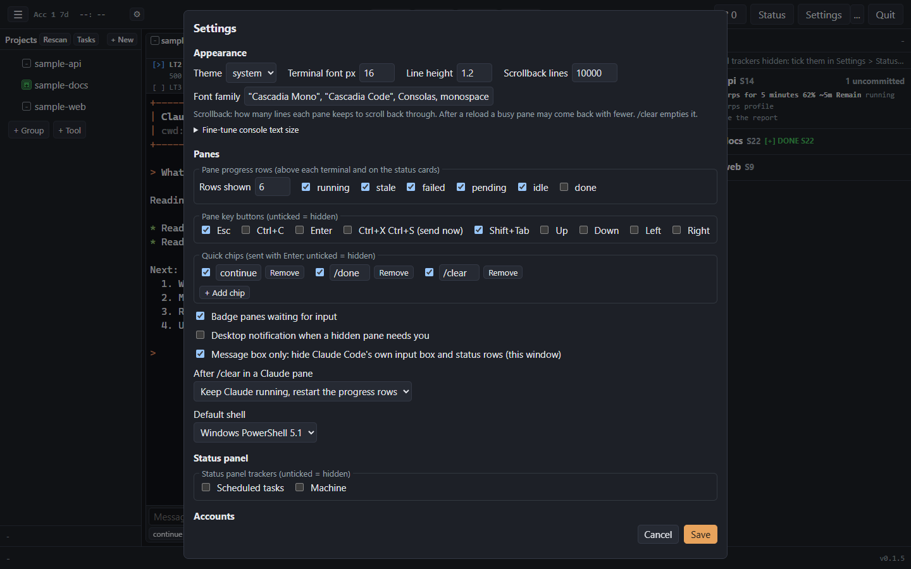

# Claude Console

[](https://github.com/Remus3/Claude-Console/releases/latest)
[](https://github.com/Remus3/Claude-Console/actions/workflows/ci.yml)
[](LICENSE)
[](https://github.com/Remus3/Claude-Console/releases)
[](#requirements)

Claude Console is a Windows desktop app for running several
[Claude Code](https://claude.com/claude-code) sessions at once. Without it, each session
sits in its own terminal window and you check each one to see whether it needs you. Here
they are tiled panes in one window, beside a list of your git projects, and one button
counts and lists the panes waiting for you. Everything runs on your own computer: the
server listens on 127.0.0.1 only and every request needs a token made at start.

## Install

Press Start, type **PowerShell**, press Enter. You do not need Run as administrator.
Paste this line and press Enter:

```powershell
irm https://github.com/Remus3/Claude-Console/releases/latest/download/install.ps1 | iex
```

That one command downloads the latest release, checks it against the release's
`SHA256SUMS.txt` and starts the console, in about a minute plus any downloads. Running
it again upgrades or repairs the install. What it changes on your computer:

- the program goes to `%LOCALAPPDATA%\Programs\claude-console`;
- Node.js and Git are installed if missing;
- **Claude Console** appears in the Start menu, on the Desktop and in Apps & features,
  and the `claude-console` command goes on your user PATH.

If Node.js or Git is missing, Windows may ask for permission to install each one.

It does not change your Claude Code settings or your projects and adds no scheduled
task. Only the optional [setup profile](#setup-profile-optional-beta) does those things,
after showing you every change.



The pictures use sample projects and a scripted stand-in for the Claude Code CLI, so the
replies in them are not real model output.

### Install without running a remote script

1. From the [latest release](https://github.com/Remus3/Claude-Console/releases/latest)
   download `install.ps1`, `claude-console-<version>.zip` and `SHA256SUMS.txt` into one
   folder.
2. Read `install.ps1`. Then, in that folder:

   ```powershell
   powershell -ExecutionPolicy Bypass -File .\install.ps1 -Zip .\claude-console-<version>.zip
   ```

   It verifies the zip and installs exactly as above. It still needs the internet, for
   the program's libraries and for Node.js and Git if they are missing.

Fully by hand (Node.js 24+ already installed): compare
`Get-FileHash .\claude-console-<version>.zip -Algorithm SHA256` with `SHA256SUMS.txt`,
extract the zip, and run in the extracted `claude-console-<version>` folder:

```powershell
node bin\claude-console.js install --repo Remus3/Claude-Console
```

Then start it from the Start menu.

## Requirements

- Windows 10 or 11.
- The Claude Code CLI, for Claude panes. Not installed yet? In PowerShell:
  `irm https://claude.ai/install.ps1 | iex`. Shell panes work without it.
- Node.js 24 or newer, and Git.
- Microsoft Edge (part of Windows) for the app window; without it the console opens
  in a normal browser tab.
- Python 3, only if you turn on setup-profile modules whose hooks are Python scripts.
  The setup names them before it writes anything.

## First run

The console opens in its own window. Later, start it from the Start menu or Desktop
(**Claude Console**), or with `claude-console start --open` in a new terminal. Closing
the window leaves your panes running; **Quit** stops them.



The left side lists the git projects it finds directly under `C:\`, in your user folder
and in its Documents, Desktop, `source\repos`, Projects and code folders. Click one to
open a Claude pane there; right-click it for a shell. To work anywhere else, click
**+ New** and pick the folder; a git project stays listed after that. Features one by
one: [docs/capabilities.md](docs/capabilities.md).

On the first start, and once after an update that changes the setup profile, the
optional setup opens as a full page. The console works without it: **Skip for now**
leaves without writing anything, and the `...` menu, **Run setup...**, brings it back.
It starts with one question:

- **Use Remus3's current settings** is the quick path for experienced users: most of what
  the author runs, plus every item the author ships on by default. It lists what stays
  off and why, asks only for what cannot be guessed (keys, your git identity and, on a
  project, values such as a short project code) and asks one yes or no for all scheduled
  tasks. Skip an input and the modules that need it stay off. With one Claude account, the
  second-account items stay off and ask nothing.
- **Custom setup** starts from the recommended set and lets you choose each module and
  each item and review every change.

Nothing is written until the last step, **Apply and verify**.



## Daily use



- Each pane is a real terminal. Type in the message box under it: **Enter** sends,
  **Shift+Enter** starts a new line, and **Attach** beside **Send** adds a file. The
  buttons below it send `continue`, `/clear` and the keys Esc and S-Tab; Settings > Pane
  key buttons adds more keys, and a phone shows them all.
- `/done`, which closes a session, is not part of Claude Code. The setup profile's
  Session shape module adds it to a project, and its button shows only where the
  command exists.
- A project that writes
  [progress files](docs/capabilities.md#6-progress-rows-and-the-eta-clock) shows them as
  rows above its panes (`[>]` running, `[ ]` to do) with percent and time left; the same
  rows sit on its card in the Status panel on the right.
- With that Session shape module, a project whose last session ended with a verified
  `/done` shows a green `DONE` mark on its card until new work starts.
- The `? N` button in the top bar counts the panes that need you (a permission prompt)
  or wait unread after a turn. It opens one line per pane, needs-you first, then oldest
  first; click a line to restore and focus that pane. **Ctrl+Alt+U** jumps to the newest
  unread pane, also from inside a terminal.
- A thin line along a pane's header shows that Claude is generating, taken from Claude
  Code's own progress signal.
- Visible panes draw with the GPU. A pane that loses its GPU context falls back to the
  regular renderer and keeps working.

## Setup profile (optional, beta)

The setup profile can set Claude Code up the way this console's author works. It is a
set of modules: a hand-off file per project and a `/done` ritual, quiet output,
test-first agents, commit identity hooks, size budgets for Claude's instruction files,
and more. Each module is a group of items, and each item says what it does, why the
author turns it on, which items it needs and which it usually goes with.

You decide what is on. Turn a module on or off as a whole, or turn single items on
and off inside it; dependencies are always shown and never switched silently. The
safety floors are the one module that is always on, because they keep the rest
reversible. Before you enable a module, read its description and the `.md` files it
adds to your project, so you know which rules Claude will follow. The full list, with
the reason each module exists and when you might turn it on later, is in
[docs/profile.md](docs/profile.md). Project modules write into the project you pick under
**Apply to**; left on your account, they are skipped and only your Claude settings change.

The same choices work from a terminal:

```powershell
claude-console profile list                      # every module and item, on or off
claude-console profile view session              # what one module or item does and why
claude-console profile enable ci-gates           # change your selection only
claude-console profile apply --target repo:C:\code\my-app             # dry run: every change
claude-console profile apply --target repo:C:\code\my-app --apply --yes
claude-console profile revert --last --apply --yes   # undo the last apply, byte for byte
```

`apply` without `--apply --yes` is always a dry run. A real apply backs up everything it
touches first, reads every write back, and rolls the whole change back if one write
fails. The setup profile never commits, never pushes and never starts a background
Claude run on its own; after an apply it prints a suggested commit message for you.



## As-is

The console and its setup profile are provided as-is under the Apache-2.0 licence, and
the author is not liable for what they do on your machine. That is why the setup shows
each change first and can undo it.

## Adopting an existing project

You can bring a project you already have in line with the profile without risking it.
The console never changes the original while it works:

1. **Copy.** It makes a full copy of the project in its data folder. You can leave out
   top-level folders such as `node_modules`, which promoting the copy keeps.
2. **Report.** It scans the copy and lists, per rule, every file and line it would
   change, with the diff, the reason and a warning where a change might break
   something (for example a data file that must keep Windows line endings).
3. **Yes or no.** You accept or refuse each module and each change.
4. **Function check.** It applies your choices to the copy, then runs your project's
   own tests, build and start command on both the original and the copy and compares
   them. If the copy does worse, it names the change that caused it and offers to undo
   just that change. You confirm with **It works**.
5. **Promote.** Only then can the copy become your project, by a git fast-forward or by
   swapping the folders, which keeps the old folder aside.
6. **Remove the original, later.** A separate step, offered at the earliest a day
   after promoting, sends the kept original to the Recycle Bin or a zip archive.

Start it from the `...` menu, **Adopt a project...**, or with
`claude-console profile adopt <project-folder> --report`. The details are in
[docs/adopt.md](docs/adopt.md).



## Privacy

Nothing you do in the console is sent to its author or to anyone else: not your files,
prompts, settings, secrets or usage. There is no telemetry and no crash upload. The
console makes exactly two kinds of network call, plus one you can turn on. One is the
update check and download from this repo's GitHub releases. The other is an action you
start yourself, such as an install step or opening an issue page or claude.ai in your
browser. The one you can turn on reads your own API spend from api.anthropic.com. The
server, the
panes and an optional background-run proxy talk over 127.0.0.1 only, and tests in this
repo fail the build if any other network call appears. The full statement, with every
allowed host, is in [docs/privacy.md](docs/privacy.md).

## Update

The console looks for a new version when you press **Check now** in Settings > Updates &
repair, or run `claude-console update --check`. Nothing checks in the background.

When a new version is out, an **Update available** badge appears; click it, or press
**Update now**. Your settings, layouts and local file changes are kept: a file you
changed is merged with the new version, and a clash is kept aside for you to review.
From a terminal: `claude-console update --yes`.

For a daily check, set up one scheduled task yourself: `claude-console autoupdate
--register`, then run the script it names. To let it install updates in a night window,
also set `"updates": {"auto": true}` in `console.local.json`.

When the author's settings change in a new version, users of the quick path see
**Update to Remus3's latest settings** with the list of changes; users of a custom
setup get the changes merged into their own choices, with any clash listed for them to
decide. Nothing is applied without the usual preview.



## If something breaks

- **Stop everything** (the `...` menu, or `claude-console stop-all --yes`) ends the
  processes the console started (its panes and background runs, by recorded process
  id only), pauses the scheduled tasks the setup profile added and turns the profile's
  hooks off. **Resume** in the same dialog, or `claude-console resume --yes`, turns them
  back on; panes it stopped stay closed until you open them. It never touches anything
  the console did not start.
- **The console itself will not start**: run the standalone recovery script. It needs
  no Node.js, no server and no network, and `-WhatIf` only shows what it would do:

  ```powershell
  $r = Get-ChildItem "$env:LOCALAPPDATA\Programs\claude-console\app\*\release\recover.ps1" | Select-Object -Last 1
  powershell -ExecutionPolicy Bypass -File $r.FullName -WhatIf -Stop -DisableHooks -PauseTasks
  ```

  `-Stop`, `-DisableHooks` and `-PauseTasks` do it, `-Resume` undoes it,
  `-Revert last` restores the files of the last profile change, and `-Prompt` writes a
  scrubbed help text for claude.ai. `recover.ps1` is also attached to every release.
- **Even the script cannot run**: [docs/recovery.md](docs/recovery.md) walks through
  the same steps by hand.

## Getting help

Settings > **Report a problem** (also on any failed setup check), or
`claude-console crash-report`, builds a short report: versions, the failing step and
the console's own recent log lines. Names, paths, tokens and anything that looks like
a secret are scrubbed, and pane output, prompts and your files are never included. You
see the exact text first, then pick one of three ways:

- **Open a GitHub issue** on this repo, pre-filled with the report.
- **Ask my Claude to fix it**: a new Claude pane gets the report and is told to find
  the cause and change nothing until you agree.
- **Save to file**, to attach or read later.

If Claude itself is broken, the `...` menu's **Get help in the browser** (or
`claude-console recover-prompt --yes`) copies a self-contained recovery text, with the
exact undo steps, to the clipboard and opens claude.ai so you can paste it into a new
chat.

## Uninstall

Apps & features > **Claude Console** > Uninstall, or in a terminal:

```powershell
claude-console uninstall
```

This removes the shortcuts, the Apps & features entry, the PATH entry and the program
files. Your settings and layouts in `%LOCALAPPDATA%\Programs\claude-console\data` stay;
`claude-console uninstall --purge` moves them to the Recycle Bin too. Node.js, Git and
Claude Code stay installed.

If a setup profile is still applied, the uninstall stops and says so, because the tool
that can undo it is about to go. `claude-console profile uninstall --all` shows what it
would remove from your Claude settings, and adding `--apply --yes` removes it (files you
edited since are kept and flagged). The same stop lists each project the profile was
applied to, with its command, and each other account's folder, which takes
`--config-dir <folder>` on that same command. Then run the uninstall again, or use
`claude-console uninstall --keep-profile` to leave the profile in place.

## Troubleshooting

| What you see | What to do |
|---|---|
| A project is not in the list | Open it once with **+ New**. To scan a whole folder, set `"scanRoots"` in `%LOCALAPPDATA%\Programs\claude-console\data\console.local.json` and restart the console. Keep what is already in that file; your edits there survive every update. A list here replaces the default one, so include the folders you still want: `{ "scanRoots": ["C:\\", "~", "~/Documents", "D:\\code"] }`. |
| `Claude Code is not installed` or `Claude Code CLI not found` | Install it: `irm https://claude.ai/install.ps1 \| iex`, then open a new pane. Installed elsewhere: set `"claudePath"` in `console.local.json` to the full path of `claude.exe`, then restart the console. |
| `Git not found` during install | The console still works; projects show without git status. Install Git (`winget install Git.Git`) and run the install command again. |
| The install stopped with a self-test failure | The output names the failing test and the error, plus the path of the full test log and the report under `%LOCALAPPDATA%\Programs\claude-console\reports`. Run the install command again after fixing the cause. |
| `claude-console` is not recognized | Open a new terminal (PATH changes reach new windows only), or use the full path `%LOCALAPPDATA%\Programs\claude-console\claude-console.cmd`. |
| The window does not open | `claude-console status` says whether the server runs; `claude-console stop`, then `claude-console start --open`. |
| `stop failed: the console server (pid N) is still running` or `uninstall incomplete: ...` | A program still holds the console open. `claude-console stop --force` ends the server; then run the uninstall again. The line names what is left. |
| Port 7800 is taken | The message names the fix: set a free `"port"` in `console.local.json`, then start again. |
| A setup check failed after Apply | The whole change was rolled back; the failed row names the item and the reason. Fix it or turn that item off, then apply again. |
| `off - needs <input>` in the setup | You skipped an input that module needs, or this computer lacks it (a second Claude account). Go Back to the step that asks for it, or leave the module off. |
| Claude behaves oddly after a profile change | `claude-console profile revert --last --apply --yes` undoes the last apply; `claude-console profile status` shows what is applied. |
| Something else is broken | `claude-console reinstall` shows a read-only report and the exact command for a repair or a fresh reinstall; your data is kept. |

## Build from source

```powershell
git clone https://github.com/Remus3/Claude-Console
cd Claude-Console
npm ci
npm test
.\launch.cmd
```

`launch.cmd` runs the server in the foreground; `launch.vbs` starts it hidden. Both
find Node.js on PATH, else in its standard install folder. `node bin\claude-console.js
release --out DIR` builds the release assets (zip, `install.ps1`, `SHA256SUMS.txt`,
notes).

## License

Apache License 2.0, see [LICENSE](LICENSE) and [NOTICE](NOTICE). Claude Console is an
independent project and is not made by or affiliated with Anthropic. Claude and
Claude Code are trademarks of Anthropic.
